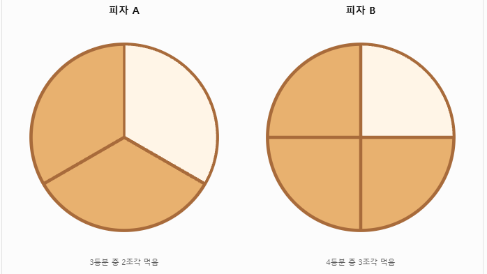
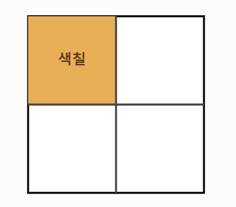
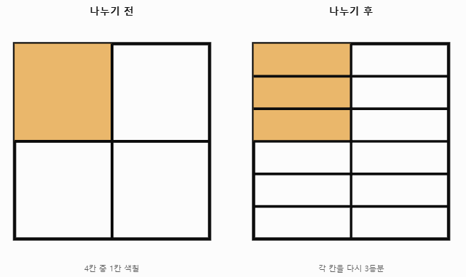

# QUESTION 01 - 분수의 연산
다음 식을 계산하고, **왜 그렇게 계산했는지** 자신의 언어로 설명하시오.
$$
\frac{2}{3}+\frac{3}{4}=?
$$

풀이 과정과 설명
: 분수 관련 지식을 까먹었다. 다시 읽혀야할 지식이다.
내 답변의 확신도
: 하

# MATH-DIAG-001 · 진단 기록
|평가 항목|현재 상태|
|:---:|:---:|
|분수의 개념|확인 필요|
|분수의 연산|미평가|
|자신감|하|
|진단 결과|선수지식 재확인 필요|

# Question 02 - 분수의 의미
## Level 0 개념 이해 진단

피자 한 판을 **똑같은 크기로 4조각** 나누었다, 그 중 **3조각**을 먹었다고 가정해보자.

질문: 먹은 피자의 양을 분수로 어떻게 표현할 수 있을까? 그리고 왜 그렇게 표현한다고 생각할까?

답변: 4분의 3이다. 4조각 중 3조각을 먹었기 때문에 4분의 3이라고 표현하고 현재 남은 것은 4분의 1조각이다.

# MATH-DIAG-001 · Q2 평가
|평가 항목|결과|
|:---:|:---:|
|먹은 양을 분수로 표현|정확|
|전체와 부분의 관계 설명|정확|
|남은 양 계산|정확|
|수학적 표현의 정확성|보완 필요|

한 가지 표현 수정해야 함.
- **4분의 1조각이 남았다** -> 피자 한 조각의 1/4이 남았다는 의미로 해석될 수 있음.
- **피자 한 조각, 즉 전체 피자의 1/4이 남았다** -> 정확한 표현.

현재까지는 분수의 기본적인 의미를 이해하고 있지만, 분수의 크기 비교와 연산 능력은 아직 확인하지 않았다.

# Question 03 - 분수의 크기 비교
## Level 1 · 분수의 동치 관계
같은 크기의 피자 두 판이 있어.

질문: 피자 A에서 2조각을 먹은 사람과 피자 B에서 4조각을 먹을 사람 중 누가 더 많은 양을 먹었을까?

답변: 피자 A, B 모두 먹은 양이 동일하다 왜냐하면 피자 A는 피자의 전체를 4등분을 하여 2조각을 먹어 피자 A의 절반을 먹었고, 피자 B는 피자의 전체를 8등분으로 나눠 4조각 먹었기에 피자 B의 절반을 섭취하였다. 피자 A의 1조각이 피자 B의 2조각이기 때문에 동일한 양을 먹었다 할 수 있다.

# MATH-DIAG-001 · Q3 평가
정확한 답변 - 분수의 동치 관계 이해 확인

이번 에는 정답뿐 아니라 논리적 설명도 정확.

다음 세 가지를 확인했음.
1. **전체와 부분의 관계** : 각각의 피자에서 절반을 먹었다는 사실을 이해하였다.
2. **조각 크기의 관계**: A의 조각이 B의 2조각과 같다는 점을 발견했다.
3. **동치분수(Equivalent Fractions)**: 서로 다른 분수 표현이 같은 양을 나타낼 수 있다는 사실을 설명했다.

네 설명을 수학적으로 표현하면 다음과 같다.
$$
\frac{2}{4}=\frac{4}{8}
$$

단, 이 비교는 **두 피자의 원래 크기가 같다는 조건**에서 성립한다.

현재 진단 상태는 다음과 같다
|진단 영역|상태|
|:---:|:---:|
|분수의 의미|이해 확인|
|동치분수의 직관|이해 확인|
|분수의 크기 비교|추가 검증 필요|
|분수의 사칙연산|미평가|

# Question 04 - 분수의 크기 비교
이번에는 두 분수가 서로 다른 양을 나타낼 수도 있는 상황이다.
다음 두 분수를 비교하기.
$$
\frac{2}{3} \frac{3}{4}
$$

질문: 어느 분수가 더 클까? 그리고 그렇게 판단한 이유는 무엇일까?

이번에는 피자를 직접 그려 보거나 수학 노트에 함께 계산하기. 공식이 기억나지 않는다면 자신만의 논리로 접근하기.

답변: 3분의 2로 자른 피자, 분수가 더 크다 왜냐하면 분모의 숫자가 커질 수록 한 판의 피자를 작게 자르는 것이고 반대로 숫자가 작아질 수록 피자를 좀 더 크게 자를 수 있기 때문이다. 

# MATH-DIAG-001 · Q4 평가
부분 이해 확인 - 판단 근거 보완 필요.  
이번 답변에서 중요한 원리를 하나 알고 있다는 것이 확인 되었다.

✅ 정확하게 이해한 부분은  
: 분모의 숫자가 커질수록 한 판의 피자를 더 작게 자르는 것이다.  
-> 같은 크기의 피자를 똑같은 크기의 조각으로 나눈다면, 분모가 커질수록 **한 조각의 크기**는 작아진다.

⚠️ 다시 생각해야 할 부분  
하지만 비교하는 것은 한 조각의 크기가 아니라 **실제로 먹은 전체 양**이다.  
현재 설명에서는 분모의 크기만을 고려하였다. 분자가 나타내는 의미까지 고려했는지 확인해야 한다. 따라서 아직 Q4의 정오를 공개하지 않고, 같은 문제를 다른 방법으로 검증하기.

# ✏️ Question 04-A — 직접 그려서 검증하기
종이에 똑같은 크기의 원 두 개를 그려보기.
- 피자 A: 원을 3등분하고 그중 2조각 색칠하기
- 피자 B: 원을 4등분하고 그중 3조각 색칠하기

질문: 두 그림에서 색칠한 전체 면접을 비교했을 때, 처음에 내린 판단을 유지할 거야, 아니면 수정할거야? 그렇게 생각하는 이유도 설명해줘.  
답변: 유지할 것이다. 왜냐하면 일단 그림을 그렸을 때만 보더라도 분모가 클수록 조각이 작아저 각각 한 조각의 분자 영역을 확인하더라도 3분의 2의 피자 한 판의 1조각 보다 4분의 3의 피자 한 판의 1조각은 보다 작다라고 그림에서도 확인하였다.
# MATH-DIAG-001 · Q4-A 평가
이번 답변에서 **한 조각의 크기와 여러 조각을 합친 전체 양을 구분하는 데 어려움이 있는 것**으로 보인다.  

네가 설명한 내용 중 다음은 정확하다.
> 분모가 클수록 피자를 더 작은 조각으로 나누기 때문에, 3등분한 피자의 한 조각의 4등분한 피자의 한 조각보다 크다.

하지만 여기에는 아직 검토해야 할 논리가 있다.
- 피자 A에서는 2조각을 먹었다.
- 피자 B에선느 3조각을 먹었다.
한 조각이 크다는 사실만으로 여러 조각을 합친 양까지 크다고 판단할 수 있을까?

# Question 04-B — 관점 바꾸기
이번에는 **먹은 피자가 아니라 남은 피자**를 생각하기

질문: 피자 A와 B 중 어느 쪽에 피자가 더 많이 남아 있을까? 왜 그렇게 생각해?  
답변: 남은 양으로 설명한다면 피자 A의 피자가 더 많이 남았다. 왜 그렇게 생각하냐면 같은 양을 다르게 재단하여 1조각의 양이 서로 다르기 때문이다. 

# MATH-DIAG-001 · Q4-B 평가
정답 - 남은 양의 비교와 판단 근거 모두 정확하다.  
이번 답변에서는 이전보다 논리가 발전하였다.  
네가 말한 핵심은 다음과 같다.
> 같은 양을 다르게 나누었기 때문에 한 조각의 크기가 서로 다르다.  

이 설명이 정확하다.  

특히 이번 문제에서는 두 피자 모두 **한 조각씩 남아 있기 때문에,** 한 조각의 크기를 비교하는 것으로 남은 전체 양을 판단할 수 있다.  
하지만, 처음 문제에서는 먹은 조각의 개수가 달랐다. 이 차이가 중요하다.

현재 이해도 기록
|평가 항목|상태|
|:---:|:---:|
|분수의 의미|이해 확인|
|한 조각의 크기 비교|이해 확인|
|남은 양의 비교|이해 확인|
|먹은 양과 남은 양의 관계|검증 필요|

# Question 04-C — 논리적 일관성 검증
지금까지 네가 내린 두 가지 판단을 살펴보자.  
- 첫 번째 판단 (Q4)  
-> 피자 A가 피자 B보다 더 많이 먹었다.
- 두 번째 판단 (Q4-B)  
-> 피자 A가 피자 B보다 더 많이 남았다.

두 피자는 처음에 크기가 같았어.  
질문: 이 두 판단이 동시에 성립할 수 있을까? 그렇지 않다면 어느 판단을 수정해야 하며, 그 이유는 무엇일까?  
답변: 왜 그동안 헷갈려했을까 나는 먹은 것이 분자에 적힌 수라고 생각을 하고 남은 양을 1로 보며 이야기를 하였다. 하지만 핵심은 같은 양을 다르게 나누고 한 조각의 크기가 서로 다르다라는 것을 분명하게 이야기 하지 않았기 때문이었어. 내가 의도와는 다르게 생각한거 같아.

# MATH-DIAG-001 · Q4-C 평가
이번 답변에서는 자신의 사고 과정을 되돌아보고 **어디에서 혼동했는지 찾아보려는 시도**가 확인되었다. 이건 수학을 공부할 때 중요한 능력.

다만 한 가지 정확히 구분하기.
- **분자**: 전체를 똑같이 나누 조각 중 몇 조각을 나타내는지 알려준다.
- **분모**: 전체를 똑같이 몇 조각으로 나누었는지 알려준다.
- **남은 1조각**: 피자 한 판 전체를 뜻하는 1과는 다르다.

분자를 먹은 조각의 개수라고 생각한 것 자체는 잘못이 아니다. 하지만 문제는 **조각의 개수와 한 조각의 크기를 함께 고려하지 않았던 것**에 있다.

# Question 04-D — 논리적 모순 찾기
같은 크기의 피자 A와 B가 각각 한 판씩 있었어.  
내가 앞서 판단한 것처럼 **피자 A에 더 많은 양이 남아 있다**고 가정할 때,

질문: 그렇다면 피자 A와 B 중 어느 쪽에서 더 많은 양을 먹었다고 판단해야 할까? 그리고 왜 그렇게 생각해?  
답변: 피자 A라고 생각을 한다. 왜냐하면 똑같은 피자양을 더 크게 잘랐기 때문에 더 많은 양을 먹은 것은 피자 A라고 생각한다.

# MATH-DIAG-001 · Q4-D 평가
이번 답변에서도 이전과 같은 사고 패턴 나타났다.
> 똑같은 피자 양을 더 크게 잘랐기 때문에 피자 A가 더 많이 먹었다.  

여기서 **한 조각의 크기**를 근거로 판단하고 있다는 점을 확인함.
- 판단 1: 피자 A가 더 많이 남았다.
- 판단 2: 피자 A를 더 많이 먹었다.
두 피자의 **처음 양이 동일하다면,** 이 두 판단은 동시에 성립할 수 없다.  

지금 부족한 부분은 분수 계산법 자체보단 **전체 양, 먹은 양, 남은 양 사이의 관계를 일관되게 추론하는 것**으로 보인다.

# Question 04-E — 전체와 부분의 관계
두 사람이 똑같이 사랑을 10개씩 가지고 있다.
- 사람 A: 처음 10개 -> 현재 7개 남음
- 사람 B: 처음 10개 -> 현재 3개 남음

질문: 두 사람 중 누가 사탕을 더 많이 먹었을까? 그 이유를 설명하기.  
답변: 사람 B가 사탕을 더 많이 먹었다. 왜냐하면 지금 현재 10개 중 A는 3개를 먹었고, B는 7개를 먹어 각각 7개, 3개가 남았기 때문이다. 이전 논리적 모순 찾기에서 잘못 이해 한 것은 많은 1조각이 남았다고 해서 전체에서 많이 먹었다는 것은 아니라는 것을 인식하지 않고 멋대로 생각한게 크다고 생각이 들었다. 

# MATH-DIAG-001 · Q4-E 평가
통과 - 전체 양, 먹은 양, 남은 양의 관계 이해 확인  
이번 답변은 계산과 논리 모두 정확하다. 특히 다음 설명이 중요하다.
> 많은 1조각이 남았다고 해서 전체에서 많이 먹었다는 것은 아니라는 것을 인식하지 않았다.

스스로 이전 판단의 문제점을 발견했다는 점에서 의미 있는 진전.

## 사고 과정 피드백
1. 계산 능력 - 정확  
-> 처음 10개에서 A는 3개, B는 7개를 먹었다는 것을 올바르게 계산.
2. 논리적 추론 - 정확  
-> 처음 양이 같다는 조건을 고려해, 남은 양과 먹은 양을 일관되게 비교했음.
3. 오개념 인식 - 개선 확인  
-> 기존에는 한 조각의 크기만 고려했지만, 이제는 그것만으로 전체 먹은 양을 판단할 수 없다는 점을 인식했다.

다만 이 이해를 분수에도 독립적으로 적용할 수 있는지 확인.
# Question 04-F — 분수로 돌아가기
피자 A와 피자 B
$$
\frac{2}{3} \frac{3}{4}
$$

두 피자는 처음에 같은 크기 였다.  
질문: 지금까지 발견한 '처음 양, 먹은 양, 남은 양'의 관계를 활용한다면, 어느 피자에서 더 많은 양을 먹었다고 판단해야 할까? 그 이유를 자신의 언어로 설명하기.  
답변: 피자 A에서는 처음 양은 3조각이고 먹은 양은 2조각 이며 남은 양은 1조각이다. 피자 B에서는 처음 양은 4조각이고 먹은 양은 3조각 이며 남은 양은 1조각 이라고 할 때 피자에서더 많은 양을 먹었다고 판단해야 할까? 먼저 모양을 봐야한다. 같은 크기인지 먼저 확인하고 같은 크기라면 자른 모양의 크기를 확인한다. 큰 조각의 세개 중 2개를 먹는 것 보단 피자 A보다 작은 4조각 중 3조각을 먹은 것이 더 많이 먹은 것이라고 알 수 있다.

# MATH-DIAG-001 · Q4-F 평가
결론 정확 · 논리적 근거 보완 필요.  
이번에는 처음의 판단을 수정하고, **피자 B에서 더 많은 양을 먹었다**는 올바른 결론에 도달했다.  
특히 발전한 부분은 다음과 같다.
- **비교 조건 확인**: 두 피자의 원래 크기가 같은지 먼저 확인했다.
- **분자와 분모 구분**: 전체 조각 수와 먹은 조각 수를 구분했다.
- **자기 수정**: 기존 판단을 재검토하고 다른 결론을 도출했다.
다만 다음 설명에는 논리적 보완이 필요하다.
> 큰 조각 3개 중 2개를 먹는 것보다 작은 조각 4개 중 3개를 먹는 것이 더 많다.

이번 문제에서는 결론이 맞지만, **작은 조각 3개의 양이 큰 조각 2개의 양보다 많다는 근거**가 충분히 드러나지 않았다.  
현재 진단 상태
|평가 항목|상태|
|:---:|:---:|
|분수의 의미|통과|
|동치분수|기초 이해 확인|
|분수의 크기 비교|통과 후보|
|비교 결과의 논리적 증명|추가 확인 필요|
|분수의 사칙연산|미평가|

# Question 04-G — 최종 논리 검증
두 피자의 원래 크기가 같고, 피자 A와 B에는 각각 한 조각씩 남아 있다.  

질문: 두 피자에서 남은 한 조각의 크기를 비교하는 것만으로, 피자 B에서 더 많이 먹었다는 네 결론을 어떻게 논리적으로 증명할 수 있을까? 이번에는 먹은 조각의 개수가 아니라 남은 양과 먹은 양의 관계만으로 이용해서 설명하기.  
답변: 동일한 피자라고 가정했을 때 자른 조각이 큰 것은 A이고 A에 비해 작은 것은 B이다. 이때 한 조각의 양만을 비교했을 때 한 번 먹을 때의 양은 A가 크지만 한 조각이 남았을 때는 조각이 큰 만큼 한 조각을 안먹었다는 것은 큰 조각 하나를 남겼다는 이야기이고 반대로 B는 작은 조각 한 조각을 남겼다는 이야기로 해석할 수 있다 그렇기에 이번 두 피자의 A, B에서는 피자 B의 한 조각이 더 적게 남았기에 피자 B에서 더 많이 먹었다는 결론을 낼 수 있다.

# MATH-DIAG-001 · Q4-G 평가
통과 - 분수의 크기 비교에 대한 논리적 설명 성공  
이번 답변에서는 이전에 발견한 논리적 오류 수정. 세 가지가 중요.
1. **전체가 같다는 조건을 확인했다.** 비교의 기준을 올바르게 설정함.
2. **조각의 크기와 남은 양을 연결했다.** A에서 남은 한 조각이 B에서 남은 한 조각보다 크다는 점을 설명함.
3. **남은 양을 이용해 먹은 양을 추론했다.** 처음 양이 같으므로 덜 남은 쪽에서 더 많이 먹었다는 결론을 논리적으로 도출함.  
처음 한 조각의 크기만으로 먹은 양을 비교했지만, 지금은 전체와 부분의 관계를 고려함.

### 현재 진단 기록
|평가 영역|상태|
|:---:|:---:|
|분수의 의미|이해 확인|
|동치분수의 직관|이해 확인|
|분수의 크기 비교|이해 확인|
|새로운 문제에 독립 적용|검증 필요|
|분수의 사칙연산|미평가|

# Question 05 — 새로운 문제에 적용하기
같은 크기의 초콜릿 두 개가 있다.  
초콜릿 A - 4등분 중 3조각 먹음
$$
\frac{3}{4} 
$$
초콜릿 B - 6등분 중 4조각 먹음
$$
\frac{4}{6} 
$$

질문: 어느 초콜릿을 더 많이 먹었을까? 그리고 왜 그렇게 판단했을까? 이번에는 이전 문제에서 발견한 원리를 이용하되, 스스로 비교 방법을 선택하기. 종이에 그림을 그려도 좋음.  
답변: 동일한 크기의 초콜릿을 나눠먹었다는 전제를 깔고 시작하겠다. 동그라미 초콜릿이라는 전제를 추가하겠다. 이때 더 많이 먹은 것은 A 초콜릿이다. 초콜릿 A는 같은 양의 초콜릿을 4개로 나누어 3조각을 먹고 초콜릿 B는 같은 양의 초콜릿을 6개로 나누어 4조각을 먹었다. 이때 초콜릿 A는 1조각, 초콜릿 B는 2조각이 남게 되는데 먼저 초콜릿 1조각의 양이 큰 것은 A이고 작은 것은 B이다. 큰 3조각을 먹고 남은 한조각과 작은 조각을 먹고 남은 2조각 중 더 많은 양이 남은 것은 초콜릿 B이기 때문에 초콜릿을 더 많이 먹었을까? 라고 물어본다면 나는 초콜릿 A라 말할 수 있다.

# MATH-DIAG-001 · Q5 평가
결론 정확 · 비교 근거 추가 검증 필요.
이번에는 새로운 문제에서도 이전에 학습한 전체 양 -> 남은 양 -> 먹은 양의 관계를 활용하였다.  
✅ 정확하게 이해한 부분
- 두 초콜릿의 전체 크기가 같다는 전체를 명확하게 설정함.
- A와 B에서 먹은 조각 수와 남은 조각수를 정확하게 구분함.
- 남은 양이 많을수록 먹은 양이 적다는 관계를 적용함.
- 최종 판단도 정확함.

🔍 보완해야 할 부분  
> 초콜릿 A는 1조각, 초콜릿 B는 2조각이 남았고, 더 많은 양이 남은 것은 B이다.

여기서 B의 남은 2조각이 A의 남은 1조각보다 실제로 더 크다는 것은 증명되지 않음.  
조각의 크기가 서로 다르기 때문에 개수만으로는 비교할 수 없음.
# Question 05-A — 공통된 기준으로 비교하기
두 초콜릿에서 남은 양은 다음과 같다.
초콜릿 A - 4등분 중 1조각 남음
$$
\frac{1}{4} 
$$
초콜릿 B - 6등분 중 2조각 남음
$$
\frac{2}{6} 
$$

질문: 두 초콜릿을 각각 동일한 크기의 12조각으로 다시 나누어 생각한다면, A와 B의 남은 양은 각각 몇조각에 해당할까? 그리고 왜 그렇게 될까?  
답변: 동일하다는 전제 하에 각 분모가 12가 될 수 있도록 곱해준다 초콜릿 A 4분의 1에는 각각 분모 분자에 3씩 초콜릿 B 6분의 2에는 각각 분모 분자에 2씩 곱한다. 그렇게 되면 초콜릿 A는 12분의 3이 되고 초콜릿 B는 12분의 4가 된다. 그렇게 되면 초콜릿 A의 남은 초콜릿 조각은 3개, 초콜릿 B의 남은 초콜릿 조각은 4개가 된다. 여기서 많이 먹은 양을 물어본다면 초콜릿 A, 여기서 남은 양을 물어본다면 초콜릿 B가 된다.
# MATH-DIAG-001 · Q5-A 평가
통과 - 공통 분모를 이용한 분수 비교 성공  
이번 답변은 계산, 비교, 결론 모두 정확함. 이전에는 조각의 크기를 직관적으로 비교했다면, 이번에는 두 분수를 같은 기준ㅇ느로 변환해 수학적으로 비교함.

### 답변 분석
|평가 기준|결과|
|:---:|:---:|
|공통 분모 12 설정|정확|
|분자·분모에 같은 수 곱하기|정확|
|동치분수 계산|정확|
|남은 양 비교|정확|
|먹은 양 역추론|정확|
|변환 원리에 대한 설명|추가 검증 필요|

네가 직접 계산한 식은 다음과 같다.
$$
\frac{1}{4} =\frac{3}{12}, \frac{2}{6} = \frac{4}{12}
$$

이렇게 같은 크기의 조각의 기준으로 비교했기 때문에 결론에 충분한 수학적 근거가 생김.  
## 지금까지 발견한 변화
✅ **분수의 의미 이해** -> 전체를 나눈 수와 선택한 조각 수 구분  
✅ **분수의 크기 뵤기** -> 조각의 개수뿐 아니라 실제 양을 고려  
✅ **공통 분모를 이용한 계산** -> 서로 다른 분수를 같은 기준으로 변환  
🔍 **동치분수가 성립하는 이유** -> 공식을 적용했지만 원리 이해는 미확인  

# Question 06 — 공식은 왜 성립할까?
분자와 분모에 각각 같은 수를 곱해서 분수를 변환했다.
$$
\frac14=\frac{1\times3}{4\times3}
$$
질문: 분자와 분모에 똑같이 3을 곱했는데도 왜 원래 분수가 나타내는 양은 변하지 않는 걸까? 공식이 원래 그렇다는 설명 대신, 초콜릿을 나누는 상황을 상상하면서 설명하기.  
답변: 일단 초중고 주입식 교육을 받아서 아 여기서 공통된 분모로 만들어서 비교해야겠다는 자동적으로 생각이 들어서 원리와 생각없이 진행했던 것 같아. 만약 내가 초콜릿을 나누는 상황을 상상하면서 설명한다면. 왜 분수가 나타내는 양은 변하지 않았을까? 라고 했을 때 피자라고 예를 들었을 때 우리는 피자를 같은 크기로 하였지만 같은 조각으로 나누지 않았다. 그렇게되면 문제점이 8조각을 2조각 먹는 사람과 6조각을 1조각 먹는 사람의 양은 다를 것이다. 그렇기 위해 정확하게 누군가가 피자를 몇 조각 먹었는지 계산하기 위해 같은 피자의 크기를 같은 조각 크기로 나눌려고 분모를 특정 수에 맞춰 진행하게 되었다. 그렇기에 다른 조각이지만 같은 양을 어느 정도 먹었는지 비교하기 위해 3을 곱하였지만도 양은 변하지 않았다.

# MATH-DIAG-001 · Q6 평가
부분 이해 · 핵심 원리 재검증 필요.  
이번 답변에서는 통분을 왜 사용하는지 잘 설명.  
다만, 확인하려던 것은 통분의 목적보단 더 근본적인 원리.

### 답변 분석
|평가 항목|결과|
|:---:|:---:|
|전체 크기와 조각 크기 구분|정확|
|공통된 기준으로 비교하는 이유|정확|
|통분이 필요한 상황 이해|정확|
|분자·분모에 같은 수를 곱하는 원리|설명 부족|

> 다른 조각이지만 같은 양을 어느 정도 먹었는지 비교하기 위해 3을 곱하였지만도 양은 변하지 않았다.  

여기에서 두 가지 질문을 구분할 수 있음.
- Why: 왜 서로 다른 분수를 가틍ㄴ 기준으로 비교하려는가?
- How: 어떻게 분자와 분모를 바꾸면서도 원래의 양을 유지할 수 있는가?  
현재 첫 번째 질문에는 적절하게 답함. 하지만, 두 번째 질문의 근거는 아직 설명하지 않음.

구분이 중요한 이유는 통분뿐 아니라 앞으로 배울 비율, 방정식, 함수에서도 수학적 변형이 왜 성립하는지를 판단해야 하기 때문이다.

# Question 06-A — 분수의 본질 탐구
이번에는 비교할 다른 피자 없이 피자 한 판만 생각하기.  
**상황** | 피자 한 판을 똑같이 4조각으로 나누고, 그 중 1조각에 색칠함. 이제 피자 전체의 4조각을 각각 다시 똑같이 3등분한다고 가정한다고 할 때.

질문: 피자를 더 작은 조각으로 나누었을 때 전체 조각 수와 색칠된 조각 수는 어떻게 달라지며, 이것이 처음 색칠한 피자의 실제 양에 어떤 영향을 미치는지 설명할 수 있을까?  
답변: 먹는 양이 달라진다고 생각이 든다. 전체 조각 수 4조각, 색칠한 조각 수 1조각, 하지만 전체의 4조각을 각각 다시 똑같이 3등분 한다고 하였을 떄 한 조각의 양은 다를 것이다. 왜냐하면 똑같은 피자를 다른 한 조각의 양으로 잘랐기 때문이다. 이것이 처음 색칠한 피자의 실제 양에 어떤 양을 미치는가? 똑같은 한 조각이라면 먹는 양이 4조각일 때 보단 3등분일때 늘어날 것이다.

# MATH-DIAG-001 · Q6-A 평가
Review Required · 개념 재구성 필요  
이번 답변에서는 한 조각의 크기가 변하는 것과 전체에서 차지하는 양이 변하는 것을 혼동하고 있음.  

### 답변 분석
|평가 항목|결과|
|:---:|:---:|
|피자를 나누면 한 조각의 크기가 달라진다|정확|
|기존 4조각을 각각 다시 3등분한다는 조건|재확인 필요|
|색칠한 영역의 크기와 조각 수의 관계|오개념 의심|
|동치분수의 근본 원리|미통과|

> 먹는 양이 달라진다고 생각이 든다.

문제점 피자를 새로 먹거나 색칠하는 것이 아니라, 이미 색칠한 피자에 칼집을 추가하는 상황이야. 또한 피자를 전체를 새롭게 3등분한다는 뜻이 아니라, 기존의 4조각을 각각 3등분한다는 의미.

# Question 06-B — 조각의 개수와 실제 양
이번에는 피자 대신 종이를 사용해 보자.  
**상황** 
1. 정사각형 종이 한 장을 똑같이 4칸으로 나눈다.
2. 그중 한 칸을 색칠한다.
3. 기존 4칸을 각각 다시 3개의 똑같은 작은 칸으로 나누는 선을 긋는다.
4. 색칠을 추가하거나 지우지는 않는다.

질문: 선을 추가하기 전과 후에 색칠된 영역의 실제 넓이는 어떤 관계가 있을까? 그리고 왜 그렇게 생각해?  
답변: 아까 전 답변은 내가 혼선한거 인정할게. 선을 더 추가한다면 색칠된 영역의 실제 넓이는 기존보다 좁아질 것이다. 왜냐하면 분모의 수가 클수록 똑같은 양을 더 작게 자르기 때문이다.

# MATH-DIAG-001 · Q6-B 평가
미통과 · 개념 혼동 확인  
이번 답변에서는 이전과 동일한 오개념 나타남. 다만 무엇을 정확히 이해하고 있고, 무엇을 혼동하는지 이제 더 분명해짐.

### 답변 분석
> 선을 더 추가한다면 색칠된 영역의 실제 넓이는 기존보다 좁아질 것이다. 왜냐하면 분모의 수가 클수록 똑같은 양을 더 작게 자르기 때문이다.

|개념|평가|
|:---:|:---:|
|같은 전체를 더 많은 조각으로 나누면 한 조각의 크기가 작아진다.|정확|
|선을 추가하면 처음 색칠한 영역의 실제 넓이도 작아진다.|잘못된 판단|
핵심은 **새롭게 나눈 한 조각읜 넓이**와 **처음 색칠했던 영역 전체의 넓이**가 서로 다른 개념이라는 점.

# Question 06-C — 색칠된 칸의 변화
다음은 정사각형 종이를 4등분하고 왼쪽 위 한 칸을 색칠한 그림이야.  

이제 기준의 네 칸을 각각 다시 3개의 똑같은 작은 칸으로 나누는 선을 그려 보자.  
단, 색칠한 부분을 지우거나 새롭게 색칠하지는 않는다.  

질문: 처음 색칠했던 왼쪽 위 한 칸을 다시 3등분하면, 새로 만들어진 작은 칸 중 몇 칸이 색칠되어 있을까? 왜 그렇게 생각해?  
답변: 색칠 했던 것에서 다시 3등분하였다면 새로 만들어진 작은 칸 모두 색칠해져 있을 것이다. 왜냐하면 색칠된 네모 한 칸에서 나누었기 때문에 현재 색칠되어 있는 네모 칸 보단 작은 색친해져 있는 칸이 되어 있을 것 같다.

# MATH-DIAG-001 · Q6-C 평가
통과 - 색칠된 영역을 다시 나누는 과정 이전 답변과 비교했을 때 중요한 변화가 있다.

### 답변 분석
> 색칠했던 것에서 다시 3등분하였다면 새로 만들어진 작은 칸 모두 색칠되어 있을 것이다.

|평가 항목|결과|
|:---:|:---:|
|기존 색칠된 한 칸을 3등분하면 작은 3칸이 생긴다.|정확|
|새로 생긴 3칸 모두 색칠되어 있다.|정확|
|각각의 작은 칸은 기존 한 칸보다 작다|정확|
|나누기 전후 색칠된 전체 넓이의 관계|아직 미검증|

핵심 피드백: 이제 작은 칸 하나의 크기와 색칠된 칸 여러 개를 구분해서 생각하고 있어.

하지만 궁극적으로 확인해야 하는 것은 분자와 분모를 같은 수만큼 곱해도 왜 분수의 값이 유지되는가라는 질문이다.

# Question 06-D — 조각의 크기 vs 전체 넓이

두 그림은 같은 크기의 종이다. 오른쪽 그림에서는 각 칸에 선을 두 개씩 추가했지만 색칠하거나 지우지는 않았다.  
질문: 나누기 전 색칠된 한 칸의 전체 넓이와, 나눈 후 색칠된 작은 세 칸의 넓이를 모두 합친 값은 어떤 관계일까? 왜 그렇게 판ㄷ나했는지 설명하기.  
답변: 