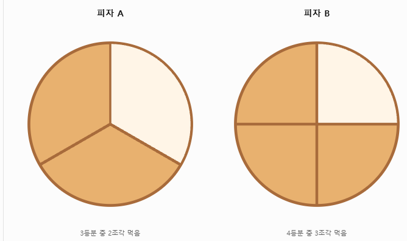

# QUESTION 01 - 분수의 연산
다음 식을 계산하고, **왜 그렇게 계산했는지** 자신의 언어로 설명하시오.
$$
\frac{2}{3}+\frac{3}{4}=?
$$

풀이 과정과 설명
: 분수 관련 지식을 까먹었다. 다시 읽혀야할 지식이다.
내 답변의 확신도
: 하

# MATH-DIAG-001 · 진단 기록
|평가 항목|현재 상태|
|:---:|:---:|
|분수의 개념|확인 필요|
|분수의 연산|미평가|
|자신감|하|
|진단 결과|선수지식 재확인 필요|

# Question 02 - 분수의 의미
## Level 0 개념 이해 진단

피자 한 판을 **똑같은 크기로 4조각** 나누었다, 그 중 **3조각**을 먹었다고 가정해보자.

질문: 먹은 피자의 양을 분수로 어떻게 표현할 수 있을까? 그리고 왜 그렇게 표현한다고 생각할까?

답변: 4분의 3이다. 4조각 중 3조각을 먹었기 때문에 4분의 3이라고 표현하고 현재 남은 것은 4분의 1조각이다.

# MATH-DIAG-001 · Q2 평가
|평가 항목|결과|
|:---:|:---:|
|먹은 양을 분수로 표현|정확|
|전체와 부분의 관계 설명|정확|
|남은 양 계산|정확|
|수학적 표현의 정확성|보완 필요|

한 가지 표현 수정해야 함.
- **4분의 1조각이 남았다** -> 피자 한 조각의 1/4이 남았다는 의미로 해석될 수 있음.
- **피자 한 조각, 즉 전체 피자의 1/4이 남았다** -> 정확한 표현.

현재까지는 분수의 기본적인 의미를 이해하고 있지만, 분수의 크기 비교와 연산 능력은 아직 확인하지 않았다.

# Question 03 - 분수의 크기 비교
## Level 1 · 분수의 동치 관계
같은 크기의 피자 두 판이 있어.

질문: 피자 A에서 2조각을 먹은 사람과 피자 B에서 4조각을 먹을 사람 중 누가 더 많은 양을 먹었을까?

답변: 피자 A, B 모두 먹은 양이 동일하다 왜냐하면 피자 A는 피자의 전체를 4등분을 하여 2조각을 먹어 피자 A의 절반을 먹었고, 피자 B는 피자의 전체를 8등분으로 나눠 4조각 먹었기에 피자 B의 절반을 섭취하였다. 피자 A의 1조각이 피자 B의 2조각이기 때문에 동일한 양을 먹었다 할 수 있다.

# MATH-DIAG-001 · Q3 평가
정확한 답변 - 분수의 동치 관계 이해 확인

이번 에는 정답뿐 아니라 논리적 설명도 정확.

다음 세 가지를 확인했음.
1. **전체와 부분의 관계** : 각각의 피자에서 절반을 먹었다는 사실을 이해하였다.
2. **조각 크기의 관계**: A의 조각이 B의 2조각과 같다는 점을 발견했다.
3. **동치분수(Equivalent Fractions)**: 서로 다른 분수 표현이 같은 양을 나타낼 수 있다는 사실을 설명했다.

네 설명을 수학적으로 표현하면 다음과 같다.
$$
\frac{2}{4}=\frac{4}{8}
$$

단, 이 비교는 **두 피자의 원래 크기가 같다는 조건**에서 성립한다.

현재 진단 상태는 다음과 같다
|진단 영역|상태|
|:---:|:---:|
|분수의 의미|이해 확인|
|동치분수의 직관|이해 확인|
|분수의 크기 비교|추가 검증 필요|
|분수의 사칙연산|미평가|

# Question 04 - 분수의 크기 비교
이번에는 두 분수가 서로 다른 양을 나타낼 수도 있는 상황이다.
다음 두 분수를 비교하기.
$$
\frac{2}{3} \frac{3}{4}
$$

질문: 어느 분수가 더 클까? 그리고 그렇게 판단한 이유는 무엇일까?

이번에는 피자를 직접 그려 보거나 수학 노트에 함께 계산하기. 공식이 기억나지 않는다면 자신만의 논리로 접근하기.

답변: 3분의 2로 자른 피자, 분수가 더 크다 왜냐하면 분모의 숫자가 커질 수록 한 판의 피자를 작게 자르는 것이고 반대로 숫자가 작아질 수록 피자를 좀 더 크게 자를 수 있기 때문이다. 

# MATH-DIAG-001 · Q4 평가
부분 이해 확인 - 판단 근거 보완 필요.  
이번 답변에서 중요한 원리를 하나 알고 있다는 것이 확인 되었다.

✅ 정확하게 이해한 부분은  
: 분모의 숫자가 커질수록 한 판의 피자를 더 작게 자르는 것이다.  
-> 같은 크기의 피자를 똑같은 크기의 조각으로 나눈다면, 분모가 커질수록 **한 조각의 크기**는 작아진다.

⚠️ 다시 생각해야 할 부분  
하지만 비교하는 것은 한 조각의 크기가 아니라 **실제로 먹은 전체 양**이다.  
현재 설명에서는 분모의 크기만을 고려하였다. 분자가 나타내는 의미까지 고려했는지 확인해야 한다. 따라서 아직 Q4의 정오를 공개하지 않고, 같은 문제를 다른 방법으로 검증하기.

# ✏️ Question 04-A — 직접 그려서 검증하기
종이에 똑같은 크기의 원 두 개를 그려보기.
- 피자 A: 원을 3등분하고 그중 2조각 색칠하기
- 피자 B: 원을 4등분하고 그중 3조각 색칠하기

질문: 두 그림에서 색칠한 전체 면접을 비교했을 때, 처음에 내린 판단을 유지할 거야, 아니면 수정할거야? 그렇게 생각하는 이유도 설명해줘.  
답변: 유지할 것이다. 왜냐하면 일단 그림을 그렸을 때만 보더라도 분모가 클수록 조각이 작아저 각각 한 조각의 분자 영역을 확인하더라도 3분의 2의 피자 한 판의 1조각 보다 4분의 3의 피자 한 판의 1조각은 보다 작다라고 그림에서도 확인하였다.
# MATH-DIAG-001 · Q4-A 평가
이번 답변에서 **한 조각의 크기와 여러 조각을 합친 전체 양을 구분하는 데 어려움이 있는 것**으로 보인다.  

네가 설명한 내용 중 다음은 정확하다.
> 분모가 클수록 피자를 더 작은 조각으로 나누기 때문에, 3등분한 피자의 한 조각의 4등분한 피자의 한 조각보다 크다.

하지만 여기에는 아직 검토해야 할 논리가 있다.
- 피자 A에서는 2조각을 먹었다.
- 피자 B에선느 3조각을 먹었다.
한 조각이 크다는 사실만으로 여러 조각을 합친 양까지 크다고 판단할 수 있을까?

# Question 04-B — 관점 바꾸기
이번에는 **먹은 피자가 아니라 남은 피자**를 생각하기

질문: 피자 A와 B 중 어느 쪽에 피자가 더 많이 남아 있을까? 왜 그렇게 생각해?  
답변: 남은 양으로 설명한다면 피자 A의 피자가 더 많이 남았다. 왜 그렇게 생각하냐면 같은 양을 다르게 재단하여 1조각의 양이 서로 다르기 때문이다. 

# MATH-DIAG-001 · Q4-B 평가
정답 - 남은 양의 비교와 판단 근거 모두 정확하다.  
이번 답변에서는 이전보다 논리가 발전하였다.  
네가 말한 핵심은 다음과 같다.
> 같은 양을 다르게 나누었기 때문에 한 조각의 크기가 서로 다르다.  

이 설명이 정확하다.  

특히 이번 문제에서는 두 피자 모두 **한 조각씩 남아 있기 때문에,** 한 조각의 크기를 비교하는 것으로 남은 전체 양을 판단할 수 있다.  
하지만, 처음 문제에서는 먹은 조각의 개수가 달랐다. 이 차이가 중요하다.

현재 이해도 기록
|평가 항목|상태|
|:---:|:---:|
|분의의 의미|이해 확인|
|한 조각의 크기 비교|이해 확인|
|남은 양의 비교|이해 확인|
|먹은 양과 남은 양의 관계|검증 필요|

# Question 04-C — 논리적 일관성 검증
지금까지 네가 내린 두 가지 판단을 살펴보자.  
- 첫 번째 판단 (Q4)  
-> 피자 A가 피자 B보다 더 많이 먹었다.
- 두 번째 판단 (Q4-B)  
-> 피자 A가 피자 B보다 더 많이 남았다.

두 피자는 처음에 크기가 같았어.  
질문: 이 두 판단이 동시에 성립할 수 있을까? 그렇지 않다면 어느 판단을 수정해야 하며, 그 이유는 무엇일까?  
답변: 왜 그동안 헷갈려했을까 나는 먹은 것이 분자에 적힌 수라고 생각을 하고 남은 양을 1로 보며 이야기를 하였다. 하지만 핵심은 같은 양을 다르게 나누고 한 조각의 크기가 서로 다르다라는 것을 분명하게 이야기 하지 않았기 때문이었어. 내가 의도와는 다르게 생각한거 같아.

# MATH-DIAG-001 · Q4-C 평가
이번 답변에서는 자신의 사고 과정을 되돌아보고 **어디에서 혼동했는지 찾아보려는 시도**가 확인되었다. 이건 수학을 공부할 때 중요한 능력.

다만 한 가지 정확히 구분하기.
- **분자**: 전체를 똑같이 나누 조각 중 몇 조각을 나타내는지 알려준다.
- **분모**: 전체를 똑같이 몇 조각으로 나누었는지 알려준다.
- **남은 1조각**: 피자 한 판 전체를 뜻하는 1과는 다르다.

분자를 먹은 조각의 개수라고 생각한 것 자체는 잘못이 아니다. 하지만 문제는 **조각의 개수와 한 조각의 크기를 함께 고려하지 않았던 것**에 있다.

# Question 04-D — 논리적 모순 찾기
같은 크기의 피자 A와 B가 각각 한 판씩 있었어.  
내가 앞서 판단한 것처럼 **피자 A에 더 많은 양이 남아 있다**고 가정할 때,

질문: 그렇다면 피자 A와 B 중 어느 쪽에서 더 많은 양을 먹었다고 판단해야 할까? 그리고 왜 그렇게 생각해?  
답변: 피자 A라고 생각을 한다. 왜냐하면 똑같은 피자양을 더 크게 잘랐기 때문에 더 많은 양을 먹은 것은 피자 A라고 생각한다.

# MATH-DIAG-001 · Q4-D 평가
이번 답변에서도 이전과 같은 사고 패턴 나타났다.
> 똑같은 피자 양을 더 크게 잘랐기 때문에 피자 A가 더 많이 먹었다.  

여기서 **한 조각의 크기**를 근거로 판단하고 있다는 점을 확인함.
- 판단 1: 피자 A가 더 많이 남았다.
- 판단 2: 피자 A를 더 많이 먹었다.
두 피자의 **처음 양이 동일하다면,** 이 두 판단은 동시에 성립할 수 없다.  

지금 부족한 부분은 분수 계산법 자체보단 **전체 양, 먹은 양, 남은 양 사이의 관계를 일관되게 추론하는 것**으로 보인다.

# Question 04-E — 전체와 부분의 관계
두 사람이 똑같이 사랑을 10개씩 가지고 있다.
- 사람 A: 처음 10개 -> 현재 7개 남음
- 사람 B: 처음 10개 -> 현재 3개 남음

질문: 두 사람 중 누가 사탕을 더 많이 먹었을까? 그 이유를 설명하기.  
답변: 사람 B가 사탕을 더 많이 먹었다. 왜냐하면 지금 현재 10개 중 A는 3개를 먹었고, B는 7개를 먹어 각각 7개, 3개가 남았기 때문이다. 이전 논리적 모순 찾기에서 잘못 이해 한 것은 많은 1조각이 남았다고 해서 전체에서 많이 먹었다는 것은 아니라는 것을 인식하지 않고 멋대로 생각한게 크다고 생각이 들었다. 

# MATH-DIAG-001 · Q4-E 평가
통과 - 전체 양, 먹은 양, 남은 양의 관계 이해 확인  
이번 답변은 계산과 논리 모두 정확하다. 특히 다음 설명이 중요하다.
> 많은 1조각이 남았다고 해서 전체에서 많이 먹었다는 것은 아니라는 것을 인식하지 않았다.

스스로 이전 판단의 문제점을 발견했다는 점에서 의미 있는 진전.

## 사고 과정 피드백
1. 계산 능력 - 정확  
-> 처음 10개에서 A는 3개, B는 7개를 먹었다는 것을 올바르게 계산.
2. 논리적 추론 - 정확  
-> 처음 양이 같다는 조건을 고려해, 남은 양과 먹은 양을 일관되게 비교했음.
3. 오개념 인식 - 개선 확인  
-> 기존에는 한 조각의 크기만 고려했지만, 이제는 그것만으로 전체 먹은 양을 판단할 수 없다는 점을 인식했다.

다만 이 이해를 분수에도 독립적으로 적용할 수 있는지 확인.
# Question 04-F — 분수로 돌아가기
피자 A와 피자 B
$$
\frac{2}{3} \frac{3}{4}
$$

두 피자는 처음에 같은 크기 였다.  
질문: 지금까지 발견한 '처음 양, 먹은 양, 남은 양'의 관계를 활용한다면, 어느 피자에서 더 많은 양을 먹었다고 판단해야 할까? 그 이유를 자신의 언어로 설명하기.  
답변: 피자 A에서는 처음 양은 3조각이고 먹은 양은 2조각 이며 남은 양은 1조각이다. 피자 B에서는 처음 양은 4조각이고 먹은 양은 3조각 이며 남은 양은 1조각 이라고 할 때 피자에서더 많은 양을 먹었다고 판단해야 할까? 먼저 모양을 봐야한다. 같은 크기인지 먼저 확인하고 같은 크기라면 자른 모양의 크기를 확인한다. 큰 조각의 세개 중 2개를 먹는 것 보단 피자 A보다 작은 4조각 중 3조각을 먹은 것이 더 많이 먹은 것이라고 알 수 있다.